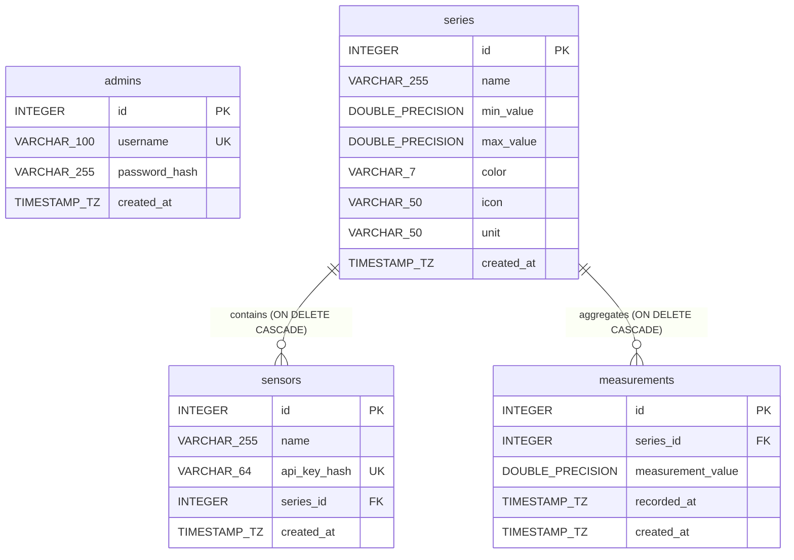

# ZAIUZ — IoT Measurement Series Platform

A containerized web platform for collecting, managing, and visualizing IoT sensor telemetry data.

---

## Quick Start (Local Setup)

### Prerequisites
- Docker Engine 24.0+ & Docker Compose v2.20+
- OpenSSL (for generating local dev TLS certificates)
- Python 3.10+ (for data generator)

### 1. Clone & Setup Environment
```bash
git clone https://github.com/Mosquito-R/ZAIUZ-2026.git
cd ZAIUZ-2026
cp .env.example .env
```

### 2. Generate Local SSL Certificates
Nginx serves HTTPS on port 443. Generate self-signed certs for local development:
```bash
mkdir -p certs
openssl req -x509 -nodes -days 365 -newkey rsa:2048 \
  -keyout certs/privkey.pem -out certs/fullchain.pem \
  -subj "/CN=localhost"
chmod 644 certs/privkey.pem certs/fullchain.pem
```

### 3. Build & Run Containers
```bash
docker compose up -d --build
```

### 4. Initialize Admin Account
Create the initial administrator user in the PostgreSQL database:
```bash
docker exec -i backend node -e '
  const argon2 = require("argon2");
  const db = require("./src/config/db");
  (async () => {
    const hash = await argon2.hash("Zaiuz123");
    await db.query(
      "INSERT INTO admins (username, password_hash) VALUES ($1, $2) ON CONFLICT (username) DO NOTHING",
      ["admin", hash]
    );
    console.log("Admin account created.");
    await db.pool.end();
  })();
'
```

Access the application in your browser: **`https://localhost/`**  
*(HTTP requests to `http://localhost/` are automatically redirected to HTTPS).*

---

## IoT Telemetry Data Generator (`generator.py`)

The project includes an IoT sensor emulator (`generator.py`) that transmits measurements directly to the REST API using a sensor API key via the `X-API-Key` HTTP header. It uses Python's standard library only (no external dependencies needed).

### Parameters
| Flag | Default | Description |
|---|---|---|
| `--url` | *required* | Full endpoint URL (e.g. `https://localhost/api/measurements`) |
| `--api-key` | *required* | Sensor API key obtained after registering a sensor in the admin panel |
| `--mode` | `past` | Mode: `past` (generates historical data back in time) or `live` (transmits in real time) |
| `--count` | `15` | Number of measurement points to generate (in `past` mode) |
| `--interval` | `5.0` | Step in seconds between points |
| `--pattern` | `random` | Value algorithm: `random` or `sine` |
| `--min` | `18.0` | Minimum value |
| `--max` | `26.0` | Maximum value |
| `--force-value` | *none* | Overrides generation with a specific float value (e.g. testing out-of-range rejection) |

### Examples

**1. Seed historical data (e.g., 20 points following a sine wave):**
```bash
python3 generator.py --url https://localhost/api/measurements \
  --api-key "YOUR_SENSOR_API_KEY" \
  --mode past --count 20 --min 15 --max 25 --pattern sine
```

**2. Stream telemetry live every 3 seconds:**
```bash
python3 generator.py --url https://localhost/api/measurements \
  --api-key "YOUR_SENSOR_API_KEY" \
  --mode live --interval 3 --pattern random
```

**3. Test validation error (send value outside allowed range):**
```bash
python3 generator.py --url https://localhost/api/measurements \
  --api-key "YOUR_SENSOR_API_KEY" \
  --force-value 999.0
```

---

## Automated Course Test Suite (`zai-tests.mjs`)

The course instructor provides an automated compliance test suite in `zai-tests.mjs` (Node.js 20+ built-in `fetch`). It verifies OpenAPI contract compliance, validation rules, HTTP headers (RFC 9457), security settings, and Lighthouse accessibility:

```bash
# Run against local stack
NODE_TLS_REJECT_UNAUTHORIZED='0' node zai-tests.mjs --app https://localhost --user admin --pass Zaiuz123 --stage E2
```

---

## Architecture

### Containers & Network Layout
- **`nginx` container:**
  - Base image: `nginxinc/nginx-unprivileged:alpine` (runs as non-root user `nginx`, UID 101).
  - Listens internally on non-privileged ports `8080` (HTTP) and `8443` (HTTPS), mapped to host ports `80` and `443`.
  - Serves static React 19 SPA files and proxies `/api/*` traffic to `backend:3000`.
  - Enforces TLS encryption (TLSv1.2/v1.3), Content-Security-Policy (CSP), and `X-Content-Type-Options: nosniff`.
- **`backend` container:**
  - Base image: `node:22-alpine` (multi-stage build, runs as unprivileged `node` user).
  - Member of **both** `frontend_net` (receives requests from Nginx) and `backend_net` (communicates with PostgreSQL).
  - Implements REST API Level 2 with RFC 9457 Problem Details error formatting, Argon2id password hashing, and SHA-256 sensor key verification.
- **`postgres` container:**
  - Base image: `postgres:16-alpine`.
  - Member of **`backend_net` only** (`internal: true`).
  - Completely isolated from the internet and from Nginx; accessible exclusively by the backend service.

---

### Database Schema (ERD)



- **`admins`**: Stores administrative credentials (`username`, Argon2id `password_hash`).
- **`series`**: Defines measurement series with numeric boundaries (`min_value`, `max_value`), visual styles (`color`, `icon`), and measurement `unit`. Deletion cascades to child sensors and measurements.
- **`sensors`**: Registered IoT devices. Stores only SHA-256 cryptographic hashes of generated 256-bit API keys (`api_key_hash`). Linked to a specific series.
- **`measurements`**: Immutable telemetry data points (`measurement_value`, `recorded_at`, `series_id`). Optimized with compound index `(series_id, recorded_at)` for fast time-series queries.

---

## Production Deployment & Admin Credentials

- **Production URL:** [https://130.61.174.17.nip.io/](https://130.61.174.17.nip.io/)
- **Admin Username:** `admin`
- **Admin Password:** `Zaiuz123`
